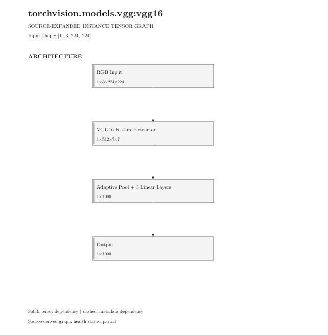
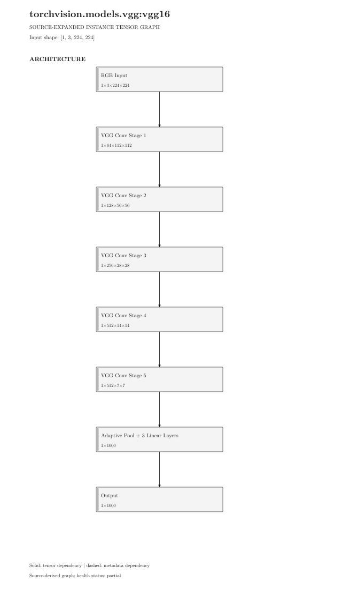
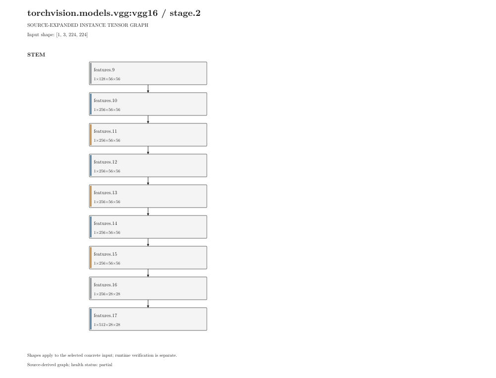
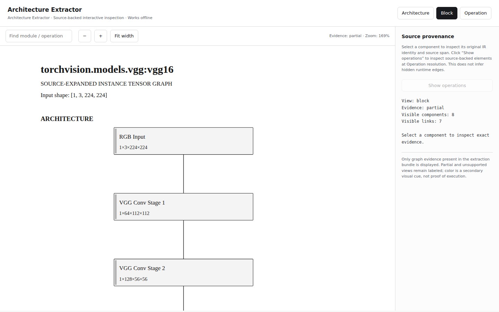

# Architecture Extractor (AE)

**Source-backed architecture extraction and visualization for Python/PyTorch models.**

AE analyzes Python source without importing or executing the target model. It extracts a traceable intermediate representation, generates Architecture / Block / Operation diagrams, and provides a self-contained offline viewer.

## Example output

Original AE diagrams from **TorchVision 0.25.0 VGG16**, default configuration, input **1 × 3 × 224 × 224**. The audited operations, dependencies, and tensor shapes were independently compared against PyTorch FX, ShapeProp, and runtime hooks.

| Architecture | Block |
| :---: | :---: |
|  |  |
| **Operation — stage focus** | **Offline viewer** |
|  |  |

[Full VGG16 Operation diagram](docs/assets/readme/vgg16-operation-full.svg) · [Independent VGG16 gate](docs/instance-forward-v0.23.md) · [Rebuild these images](scripts/generate_readme_gallery.py)

The complete operation graph contains **42 FX operations and 41 ordered dependencies**. The focused view is a source-backed subset of that graph.

## Install

Requires Python 3.11+. **PyTorch is not required** for static extraction or the viewer.

Published on [PyPI](https://pypi.org/project/architecture-extractor/):

~~~bash
python -m pip install architecture-extractor
~~~

From source, with vector export dependencies:

~~~bash
git clone https://github.com/fthyco/Architecture-Extractor-AE.git
cd Architecture-Extractor-AE
python -m pip install -e '.[render]'
~~~

## Quickstart

~~~bash
ae extract ./model-source --entrypoint model:Model --output bundle
ae validate bundle
ae inspect bundle
ae viewer bundle --output viewer
~~~

Open `viewer/index.html` in a browser. It works offline and provides three hierarchy levels, zoom/pan, search, source inspection, and drill-down.

For SVG/PDF/TikZ export, install the optional renderer:

~~~bash
python -m pip install 'architecture-extractor[render]'
ae present bundle --view structure --level operation --format all --output figures
~~~

Bundles preserve original source references, dependency evidence, node identities, hashes, unresolved facts, and manifests.

## Verified models

| Model | Original reference | Verified scope |
| --- | --- | --- |
| ResNet18 / ResNet50 | TorchVision | Pinned default factory and audited inputs |
| DenseNet121 | TorchVision 0.25.0 | Pinned default factory and audited inputs |
| U-Net / ResNet34 | SMP 0.6.0 | Pinned source, config, and inputs |
| ViT-Tiny | timm 1.0.22 | Pinned 12-block model and explicit attention mode |
| MobileNetV3 Small | TorchVision 0.25.0 | Default factory and audited inputs |
| VGG16 | TorchVision 0.25.0 | Default factory and audited inputs |
| EfficientNet-B0 | TorchVision 0.25.0 | Default factory and audited inputs |

**Validation:** independent FX graphs, ordered operand edges, ShapeProp shapes, real forward hooks, source fingerprints, figure-to-IR provenance, deterministic extractions, regression tests, Chromium viewer tests, and clean wheel installation. Claims are limited to the exact configurations documented in [docs/](docs/).

## Boundaries

- The default extractor never runs analyzed model code. A source relationship is **not** automatically an executed tensor dependency.
- Exact instance-forward fidelity is verified only for the pinned references and inputs above. Unsupported or dynamic paths remain explicitly unresolved.
- AWN and Chessformer CF-ACT/CF-CAH have source-backed structural audits, **not verified full runtime equivalence**. [Research scope](docs/phase2-research-benchmark.md).
- `ae runtime-audit` is a separate opt-in FX/hooks reference for **trusted** code; it executes that code and does not itself prove AE-to-runtime equivalence. [v0.27 scope](docs/v027-generalization.md).

## Development

~~~bash
python -m pip install -e '.[dev,render]'
python -m pytest -q
~~~

[Limitations](docs/limitations.md) · [Validation details](docs/v027-generalization.md) · [v0.27.0 release](https://github.com/fthyco/Architecture-Extractor-AE/releases/tag/v0.27.0)
